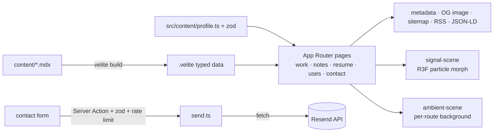

# Hein Thant — portfolio

Personal site of a full-stack & DevOps engineer. Next.js 16 (App Router, Cache Components), React Three Fiber, Lenis, Velite (MDX), Tailwind, shadcn/ui.

The home hero is "Signal": one particle field that morphs, as you scroll, from the name into an interface, an API graph, data discs, an infra cluster and a shipped globe. Every route also has a light ambient 3D background. Dark and light mode follow the OS on first visit, and the 3D scenes change their mood with the theme.

## Run

```bash
pnpm install
pnpm dev            # http://localhost:3000
docker compose up   # production build (standalone, non-root, healthcheck)
```

Demo: [`public/media/demo.mp4`](public/media/demo.mp4) (59 s walkthrough; regenerate with `BASE_URL=… node scripts/demo-video.mjs`).

## Deploy

Not deployed yet. Two easy options:

- **Vercel**: import the repo, set the env vars below, done. No extra config needed.
- **Docker on any host**: `docker build -t portfolio .` then `docker run -p 3000:3000 --env-file .env portfolio`. The image is a Next.js standalone build (~360 MB), runs as a non-root user and has a healthcheck. Put it behind a reverse proxy that sets `X-Real-IP` so the contact rate limit sees the visitor IP.

## Environment

Copy `.env.example` to `.env.local` and fill in the values. All of them are optional in dev.

| Name | Used for |
|---|---|
| `RESEND_API_KEY` | Contact form delivery through the Resend HTTP API |
| `CONTACT_TO_EMAIL` | Inbox that receives contact messages |
| `CONTACT_FROM_EMAIL` | Verified sender, e.g. `Portfolio <contact@yourdomain.com>` |
| `NEXT_PUBLIC_SITE_URL` | Canonical origin for metadata, sitemap and RSS |

Without `RESEND_API_KEY` + `CONTACT_TO_EMAIL`, the form only logs the message length in dev. In production it fails closed and shows the visitor a direct mailto link.

## Architecture



- `src/features/signal-scene`: hero. `shapes.ts` builds the six point formations, `timeline.ts` maps scroll progress to a morph (pure function of progress), and `SignalHero` drives it with eased progress. Rendering pauses when the hero is off-screen or the tab is hidden.
- `src/features/ambient-scene`: route backgrounds, masked behind the content column so text stays readable.
- `src/features/contact`: Server Action, zod validation, in-memory rate limit (keyed by `x-real-ip`, else the last `x-forwarded-for` hop).
- Scroll reveals are CSS scroll-driven animations (`animation-timeline: view()`). Smooth scroll is Lenis, with wheel deltas capped for high-sensitivity mice.
- Security headers (nosniff, frame-ancestors none, HSTS, …) live in `next.config.ts`.

## Scripts

| Script | What it does |
|---|---|
| `pnpm lint` / `pnpm format` | Biome check / fix |
| `pnpm typecheck` | `tsc --noEmit` |
| `pnpm test` | Vitest units |
| `pnpm e2e` | Playwright e2e + axe on :3100 (run `pnpm build` first) |
| `pnpm lhci` | Lighthouse CI budgets on :3200 |
| `pnpm resume:pdf` | Regenerate `public/resume.pdf` from `/resume` (needs a running server) |
| `pnpm hero:poster` | Regenerate the reduced-motion hero posters (needs a running server) |

See `docs/EDITING.md` to change content and `content/TODO-CONFIRM.md` for copy that still needs the owner's sign-off. Design decisions are in `docs/design/DECISIONS.md`.

## Known limitations

- Reduced-motion and no-JS visitors see the tall scroll layout of the hero until hydration swaps in the static poster.
- The rate limit is per process (in memory). Use a shared store (e.g. Redis) when running more than one instance.
