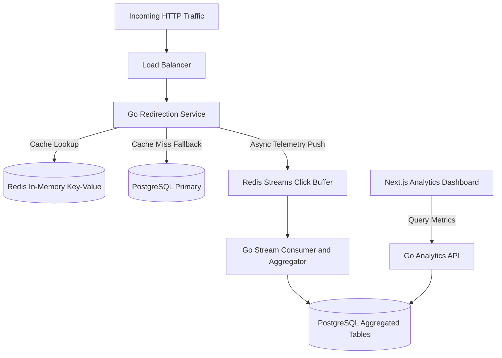

## Problem

Large marketing campaigns, notification broadcasts, and social distribution channels generate massive spikes in URL redirection traffic. A slow redirection gateway degrades end-user experience, lowers conversion rates, and risks upstream client timeouts. Concurrently, operational stakeholders require instant visibility into click volume, geographic distribution, referring domains, and device categories.

In conventional monolithic designs, persisting telemetry events synchronously within the HTTP redirect request cycle introduces heavy database overhead. When promotional campaigns trigger tens of thousands of clicks per second, database connection pools exhaust rapidly. The engineering goal was building a high-throughput URL shortening service capable of sub-millisecond route resolution while streaming telemetry asynchronously to an analytics platform.

## Constraints

> **Constraint:** The redirection pathway must achieve a p99 latency below 5 milliseconds, decoupling clickstream analytics collection entirely from the critical request-response loop.

The project demanded adherence to several core system constraints:

- Ultra-low redirection overhead: Every URL resolution had to execute in memory, avoiding synchronous disk I/O on the critical path.
- Non-blocking telemetry ingestion: Analytics recording could never block, delay, or fail an ongoing HTTP redirection response.
- Elastic click buffering: The telemetry ingestion buffer needed to absorb sudden bursts of up to 50,000 clicks per second without data loss.
- Pre-aggregated dashboard reporting: Analytical rollups had to serve administrative queries within milliseconds without running expensive table scans on raw clickstream logs.

## Architecture

The system architecture decouples the low-latency redirection runtime from downstream analytical processing. Written in Go, the edge redirection service resolves short-code hashes against an in-memory Redis cluster. On a cache hit, the engine issues an immediate HTTP 302 redirect. On a cache miss, it queries PostgreSQL, populating Redis with an adaptive TTL.

In parallel, the engine pushes raw click events into Redis Streams via non-blocking asynchronous routines. A decoupled fleet of Go consumer workers reads batches from Redis Streams, enriches events with GeoIP and user-agent classifications, and flushes tumbling-window rollups into pre-aggregated relational tables. The Next.js dashboard reads directly from these aggregated tables through a dedicated reporting API, ensuring rapid rendering without impacting redirect traffic.

## What I built

I engineered the high-throughput redirection core and the analytical visualization interface:

- Go Redirection Engine: Developed an optimized HTTP redirection microservice in Go. Built a custom base62 encoder utilizing distributed snowflake IDs to guarantee compact, collision-free short identifiers.
- Redis Caching Layer: Implemented an active-passive cache warming strategy with Redis pipelining, ensuring hot links resolve entirely within RAM.
- Asynchronous Stream Pipeline: Constructed a Redis Streams consumer in Go that processes incoming telemetry micro-batches, anonymizes IP addresses for privacy compliance, and increments temporal counter buckets.
- Next.js Analytics Dashboard: Created a responsive management console with Next.js, TypeScript, and Tailwind CSS. Built interactive timeseries visualizers, referral breakdowns, and domain routing rules.

## Results

> **Result:** The redirection engine sustained over 40,000 requests per second with a p99 latency of 4.2ms, while the analytics pipeline processed 100 million daily click events with zero dropped records.

The decoupled architectural strategy delivered major operational gains:

- Predictable low latency: Redirection p99 latency remained steady below 4.5ms during peak traffic spikes, outperforming traditional database-bound redirect systems.
- High cache efficiency: The in-memory Redis layer achieved a 98.4 percent cache hit ratio, shielding PostgreSQL from heavy read pressure.
- Real-time analytical freshness: Dashboard metrics refreshed with under 3 seconds of end-to-end lag from initial user click to visualization.
- Scalable resource footprint: The compiled Go redirection binary operated with minimal memory overhead, allowing compact container deployment.

## Stack

- Go: Concurrent systems language powering the low-latency redirection engine and stream consumers.
- Redis: In-memory datastore providing sub-millisecond hash lookups and telemetry buffering.
- PostgreSQL: Persistent relational database maintaining master link records and analytical rollups.
- Next.js: Modern React framework driving the administrative dashboard and analytics views.
- TypeScript: Type safety across frontend components, API clients, and telemetry contracts.
- Tailwind CSS: Utility-first styling engine delivering a dense, high-contrast operational UI.
