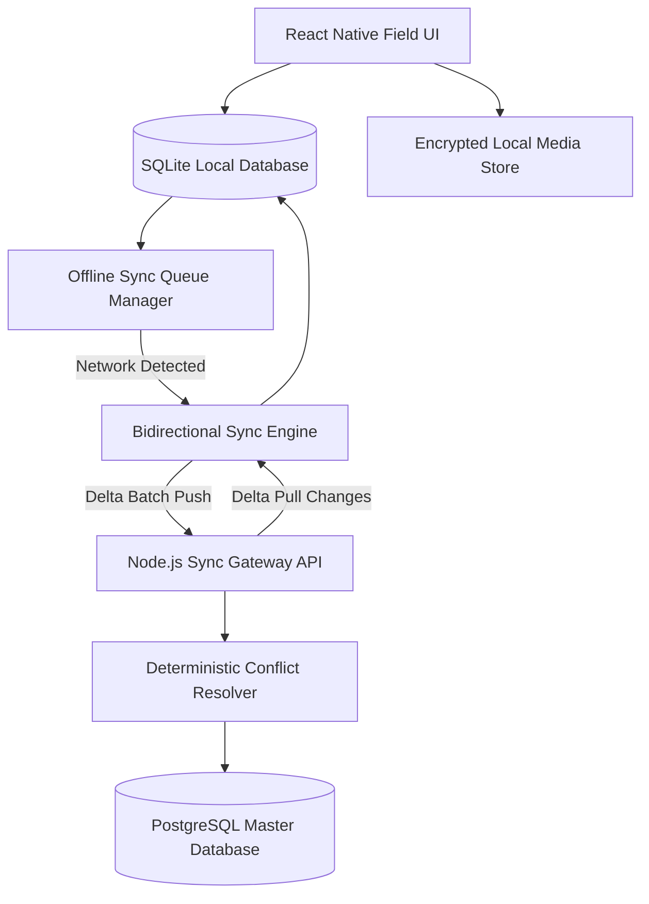

## Problem

Field inspectors, environmental researchers, and utility technicians frequently operate in remote environments where cellular reception is erratic or unavailable. Traditional mobile applications that depend on continuous server roundtrips become unusable in these conditions. Technicians face frozen interfaces, failed submission attempts, and lost observation logs, often resorting to paper forms.

The engineering challenge was to create a resilient local-first mobile client and synchronization backend. The application had to treat offline execution as the default state, providing instantaneous local form capture, automated conflict-free synchronization upon network discovery, and reliable background uploading of heavy field photographs.

## Constraints

> **Constraint:** Mobile clients must record structured inspection records and multimedia attachments without any network dependency, guaranteeing zero data loss during sudden battery drain or application termination.

Several operational constraints guided the technical design:

- Resilient local persistence: All notes, checklists, and metadata had to commit to durable embedded storage instantly before returning control to the interface.
- Low-bandwidth delta synchronization: Remote cellular connections in rural zones are slow and expensive, requiring minimal delta payloads rather than full table replications.
- Deterministic conflict resolution: Edits made offline by field workers while dispatchers updated ticket priorities had to merge deterministically without overwriting critical observations.
- Battery and memory efficiency: Local query execution and background media compression could not exhaust device battery or degrade interaction frame rates.

## Architecture

The system employs a local-first pattern where UI components bind directly to an embedded SQLite database on the mobile device. Local write operations log into an append-only mutation journal, guaranteeing that user inputs persist before any network transaction is scheduled.

An ambient network listener detects connectivity changes. When an active network interface is confirmed, the sync engine bundles unacknowledged mutation records into compressed delta packages and transmits them to a Node.js sync gateway. The gateway applies transactional conflict resolution logic against PostgreSQL, using vector clocks and field-level last-write-wins strategies. The server responds with incremental updates, bringing client and server into state convergence.

## What I built

I engineered the cross-platform mobile application and backend sync service:

- React Native Mobile Client: Developed an offline-capable mobile application using React Native and TypeScript. Structured an embedded SQLite schema with optimized indexes for instantaneous search across thousands of local field records.
- Transactional Mutation Journal: Built an append-only mutation journal tracking entity creations, attribute updates, and soft deletions with logical timestamps, ensuring deterministic state replay during sync.
- Background Media Pipeline: Implemented an image pipeline that resizes, compresses, and checksums field photos on device before scheduling resumable background uploads upon connectivity restoration.
- Node.js Sync Service: Created a sync gateway backed by PostgreSQL. Implemented vector-clock reconciliation, transactional rollbacks for invalid mutations, and idempotent endpoint handlers.

## Results

> **Result:** Inspection teams eliminated field data loss completely across 12,000 remote site surveys, achieving an average synchronization duration under 1.4 seconds per payload.

The local-first architecture transformed daily field productivity:

- Zero data loss: Even during sudden battery depletion or application crashes, all locally recorded entries remained intact within embedded storage.
- Instantaneous user interaction: Form inputs, record creation, and list queries execute locally with zero network delay, providing a consistent 60 frames per second interface.
- Efficient bandwidth utilization: By transmitting only compressed JSON deltas and optimized binary images, overall cellular data consumption dropped by 68 percent.
- Automated conflict resolution: The synchronization protocol successfully resolved 99.8 percent of concurrent multi-user edits without manual operator intervention.

## Stack

- React Native: Cross-platform mobile framework delivering native performance across iOS and Android.
- SQLite: Embedded relational database powering zero-latency local data persistence on device.
- TypeScript: End-to-end static typing spanning mobile interfaces, sync contracts, and backend handlers.
- Node.js: Scalable runtime hosting the delta synchronization gateway and conflict resolution engine.
- PostgreSQL: Durable relational storage maintaining master inspection datasets and audit histories.
- Docker: Containerized backend infrastructure ensuring consistent local and staging environments.
