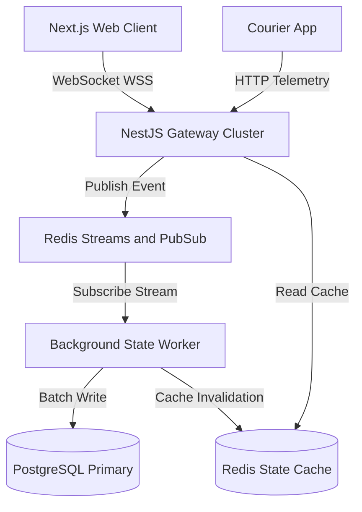

## Problem

Modern on-demand logistics platforms require immediate visibility into dispatch progress, courier routing, and delivery state transitions. Traditional HTTP request-response polling introduces severe latency lags and causes database thrashing when thousands of concurrent clients poll every few seconds. During peak delivery surges, polling architecture breaks down, leading to stale order views, delayed courier dispatching, and high cloud infrastructure costs.

The core challenge was building an end-to-end event-driven coordination layer that delivers real-time updates to thousands of browser and mobile clients simultaneously without exhausting database connections or dropping state events.

## Constraints

> **Constraint:** All client connections must maintain state convergence under intermittent network drops without saturating the primary transactional PostgreSQL cluster.

The system had to operate under strict technical boundaries:

- High concurrency handling: The architecture required persistent WebSocket connections capable of supporting over 25,000 active sessions on modest compute resources.
- Zero message loss: Critical delivery status updates, such as payment confirmations and drop-off verifications, could not be lost during transient socket disconnects.
- Transactional isolation: Telemetry updates emitted every few seconds by couriers could not write directly to PostgreSQL, as the write volume would exhaust connection pools.
- Strict payload budgets: Telemetry payloads needed to stay compact for mobile clients operating on low-bandwidth networks.

## Architecture

The architecture decouples telemetry ingestion from relational persistence. A stateless NestJS gateway cluster handles WebSocket connections from web clients and incoming HTTP telemetry updates from courier applications. Ingress events publish immediately to Redis Streams, which acts as a durable, memory-efficient message buffer.

Dedicated background workers consume events from Redis Streams in micro-batches, persisting milestone checkpoints into PostgreSQL while keeping an active state snapshot in Redis. When a client reconnects, the gateway reads the snapshot directly from Redis, eliminating repetitive queries to the primary database. Real-time updates broadcast instantly to clients via Redis PubSub channels.

## What I built

I designed and implemented the streaming infrastructure and client experience:

- NestJS WebSocket Gateway: Built a horizontally scalable gateway tier using Socket.IO adapters backed by Redis. Implemented custom JWT authentication handshakes, heartbeat monitors, and room-based channel partitioning.
- Resilient Ingestion Pipeline: Configured Redis Streams for event buffering, paired with a worker process that batches high-frequency coordinates before executing bulk upserts into PostgreSQL.
- Database Schema and Connection Management: Structured an event-sourcing ledger in PostgreSQL for auditable delivery milestones, while routing telemetry lookups through Redis. Configured PgBouncer connection pooling to guarantee steady limits.
- Next.js Realtime Interface: Developed a customer-facing tracking dashboard in Next.js featuring a dynamic map canvas and status timelines. Built resilient client connection wrappers with exponential backoff and automatic sequence reconciliation after network recovery.

## Results

> **Result:** The platform sustained 25,000 active concurrent connections with a p99 broadcast latency under 85ms while reducing database write IOPS by 74 percent.

The event-driven architecture successfully eliminated polling bottlenecks:

- Sub-second delivery visibility: End users received courier coordinates and milestone transitions with an average propagation delay of 65ms across global edge locations.
- Database protection: Shifting telemetry into Redis Streams prevented connection exhaustion, allowing the PostgreSQL database to operate smoothly under minimal CPU utilization.
- Resilient client reconnection: During synthetic network disconnect tests, web clients recovered seamlessly without manual page refreshes, automatically fetching missing sequence deltas upon socket re-establishment.

## Stack

- Next.js: Responsive customer-facing tracking dashboard and courier dispatch views.
- NestJS: Modular backend service coordinating WebSocket gateways and REST endpoints.
- WebSockets: Bi-directional persistent communication channels for real-time telemetry.
- Redis: High-performance PubSub message broker and ephemeral state cache.
- PostgreSQL: Durable relational storage for transactional order data and audit trails.
- TypeScript: Strict end-to-end type safety spanning backend DTOs and frontend client state.
