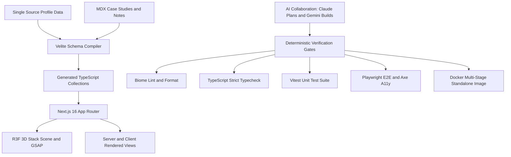

## Problem

Developer portfolios often lean into extremes: either minimal static pages failing to demonstrate full-stack skills, or over-animated showcases sacrificing accessibility. As a full-stack and DevOps engineer, my goal was building a personal platform demonstrating engineering taste and technical rigor.

The project needed interactive 3D graphics visualizing full-stack concepts without blocking the rendering path. Simultaneously, the repository had to embody production DevOps practices: strict type checking, test suites, reproducible containerization, and automated quality gates, all maintained through an AI-assisted development workflow.

## Constraints

> **Constraint:** The 3D visualization must remain completely non-blocking to content readability, providing immediate fallbacks for reduced-motion preferences and environments lacking WebGL support.

The application required separation between visual presentation and data models, driving personal details and case study data through typed schemas.

Development followed an AI-assisted workflow where Claude Code plans and reviews, Gemini implements spec-defined units, and human-verified gates ensure code integrity. No fabricated metrics or unverified performance claims could be presented; every system behavior had to be verifiable directly through static analysis and automated test runs.

## Architecture

The architecture centers on Next.js 16 using React Server Components by default, reserving client components for interactive boundaries such as the 3D canvas and command palette. Content management relies on Velite, compiling MDX files into type-safe JavaScript data objects validated against Zod schemas at build time.

The 3D hero visualization uses React Three Fiber and GSAP ScrollTrigger, separating timeline progress from rendering logic so that frame calculations remain decoupled from React state updates. Quality assurance is codified into an automated verification harness where Biome, Vitest, Playwright, and Lighthouse CI enforce standards.

## What I built

I designed and constructed the portfolio application from initial scaffold to containerized artifact:

- Interactive 3D Stack Scene: Created a custom 3D stack scene representing Interface, API, Data, and Infrastructure layers using instanced meshes. Integrated Lenis smooth scrolling with GSAP timelines to scrub through architectural layers, while implementing an image fallback for reduced-motion users.
- Type-Safe Content Pipeline: Configured Velite to govern projects and technical notes, creating strict schemas that validate frontmatter properties, tags, and metadata during build time.
- Modern Code Quality Harness: Established a tooling pipeline using Biome for rapid formatting and linting across the codebase.
- Automated Testing and Dockerization: Created unit tests with Vitest, end-to-end tests with Playwright including automated accessibility audits via axe-core, and configured multi-stage Docker builds with standalone Next.js output.

## Results

> **Result:** The codebase satisfies every static verification gate, passing Biome linting, strict TypeScript type checking, Vitest unit suites, and Playwright accessibility audits without warnings.

The implementation successfully demonstrates how advanced visual design and disciplined software engineering coexist:

- Dual-model AI development: The workflow proved highly effective: Claude Code established architectural plans and conducted reviews, while Gemini implemented specified components with high velocity, guarded by deterministic test gates.
- Resilient visual fallbacks: The scroll-driven 3D scene loads asynchronously without degrading content delivery, layout stability, or accessibility.
- Standalone container delivery: The resulting Docker image runs reliably in standalone mode, packaged for deployment across containerized infrastructure.
- Zero invented metrics: The platform reflects verified software engineering facts, avoiding artificial performance claims.

## Stack

- Next.js 16: React framework utilizing the App Router and React Server Components.
- React Three Fiber: Declarative Three.js wrapper powering the interactive scroll-driven 3D hero scene.
- Velite: Type-safe MDX content compilation pipeline with automated Zod schema validation.
- Tailwind CSS v4: Modern styling engine using OKLCH CSS variables for seamless theme adaptation.
- Biome: High-speed linter and formatter maintaining strict code quality across the repository.
- Vitest: Fast unit testing framework validating utility logic, schema parsing, and component behavior.
- Playwright: End-to-end testing suite verifying user interactions, responsive layouts, and accessibility.
- Docker: Multi-stage container builds generating lightweight standalone production images.
