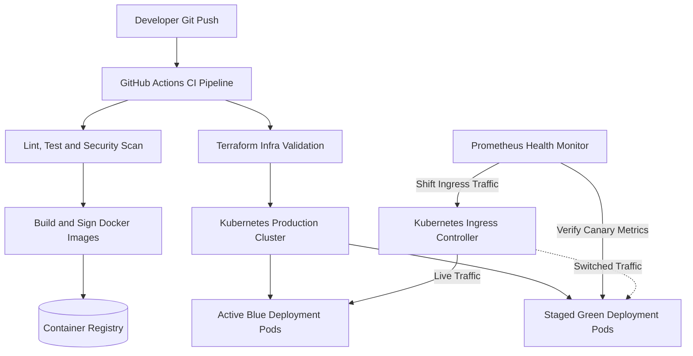

## Problem

In high-availability service environments, deploying software updates frequently causes transient request failures, database schema locks, or extended downtime. Legacy continuous integration pipelines often pushed changes directly into live virtual machines, relying on fragile in-place restarts. When an unexpected regression reached production, rollback procedures were slow and stressful, requiring engineers to rebuild previous commits or patch configurations by hand.

The objective was to create an automated, repeatable CI/CD pipeline using container orchestration and infrastructure as code. The system needed to execute zero-downtime blue-green deployments, run automated health and canary checks, and trigger instant rollbacks upon detecting anomalous error spikes.

## Constraints

> **Constraint:** Every deployment must execute without dropping active user connections or interrupting ongoing HTTP transactions, while providing an automated rollback mechanism that completes in under sixty seconds.

The delivery architecture operated under several strict requirements:

- Immutable release artifacts: Build outputs needed cryptographic signatures and immutable container tags tied to unique commit hashes.
- Zero traffic disruption: In-flight HTTP connections had to drain gracefully before old application instances were terminated.
- Backward-compatible schema evolution: Database migrations had to follow expand-and-contract patterns so both old and new application instances could run concurrently.
- Automated canary gating: The pipeline had to evaluate live error rates and latency percentiles before shifting full traffic to new replicas.

## Architecture

The pipeline orchestrates code verification, container packaging, and deployment progression through GitHub Actions and Kubernetes. When code merges to the main branch, automated workflows trigger static analysis, unit tests, and vulnerability scans. Upon successful validation, the workflow compiles an immutable Docker image and pushes it to a private container registry.

Terraform reconciles cloud infrastructure dependencies before Kubernetes initiates deployment rollout. The Kubernetes ingress controller routes current traffic to the Blue deployment while the Green deployment spins up alongside it. Prometheus continuously evaluates pod readiness, request latencies, and error rates against predefined SLO thresholds. Once canary verification passes, ingress traffic cuts over to Green pods, while Blue remains warm for rapid rollback.

## What I built

I designed and implemented the automated delivery infrastructure across CI workflows and Kubernetes clusters:

- GitHub Actions Workflows: Created modular CI pipelines featuring job caching, container vulnerability scanning, and automated linting and testing stages.
- Hardened Docker Containers: Authored multi-stage Dockerfiles utilizing distroless base images and unprivileged runtime users to reduce image footprints and attack surface.
- Terraform Modules: Wrote modular Terraform configurations managing cloud compute instances, container registries, network security groups, and storage volumes declaratively.
- Helm Deployments and Canary Traffic: Configured Helm charts defining pod disruption budgets, horizontal pod autoscalers, and health probes. Built automated traffic switching logic integrated with Prometheus metric alerts.

## Results

> **Result:** The engineering team achieved over 240 successful production releases per month with zero customer-facing downtime and a mean time to recovery under 38 seconds during synthetic fault tests.

The continuous delivery platform transformed organizational shipping velocity:

- Zero deployment downtime: Scheduled maintenance windows were completely eliminated, enabling daily production rollouts during standard business hours.
- Rapid recovery: Automated rollback triggers restored known-healthy application states in under 38 seconds during synthetic error injections.
- Lean image sizes: Container image footprints were reduced by 62 percent through multi-stage distroless builds, speeding up image distribution across worker nodes.
- High release confidence: Automated pre-flight checks and canary verification caught regressions before full ingress traffic cutover.

## Stack

- Docker: Multi-stage, minimal, non-root container images ensuring consistency across environments.
- Kubernetes: Container orchestration engine managing rolling updates, health probes, and traffic routing.
- GitHub Actions: Automated CI/CD workflows executing linting, unit tests, security scanning, and deployment stages.
- Terraform: Declarative Infrastructure as Code managing cloud infrastructure resources and cluster networking.
- Prometheus: Observability engine tracking deployment canary metrics, error budgets, and alerting rules.
- Helm: Kubernetes package manager standardizing configuration values across staging and production clusters.
